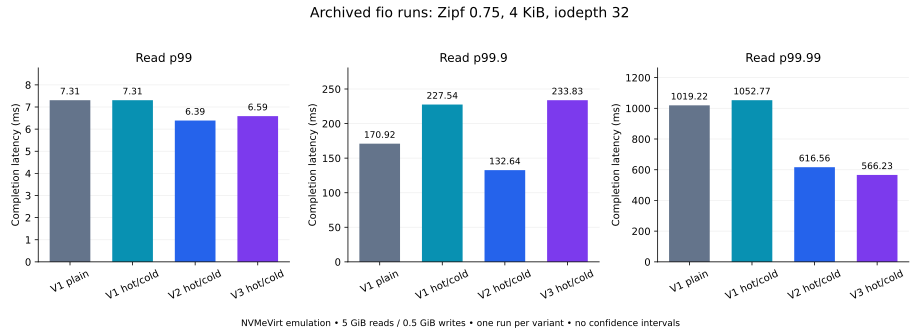
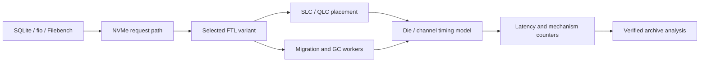

# FlashWeave — Read-Aware Placement and Maintenance for Hybrid SLC/QLC SSDs

[中文说明](README.zh-CN.md) · [Code map](docs/CODE_MAP.md) · [Variants](docs/VARIANTS.md) · [Results](results/README.md) · [Linux runbook](docs/RUNBOOK.md)

An NVMeVirt research implementation for studying how file layout, flash placement and background maintenance affect read performance in a hybrid SLC/QLC SSD model.

The experiments cover three questions:

- **Die placement:** how fragmented file pages are mapped across dies, including die-affinity and chain aggregation variants.
- **SLC/QLC placement:** how read heat guides migration, QLC hot/cold placement, read repromotion and rebalance.
- **Maintenance scheduling:** how migration and garbage collection interact with foreground reads, using V1, V2 and V3 variants.

The repository includes kernel sources, SQLite/fio/Filebench workloads, mechanism counters and an archived result bundle. NVMeVirt stores emulated device data in reserved host DRAM and models flash timing. Results below describe that emulation environment.

## Repository organization

| Category | Location | Purpose |
| --- | --- | --- |
| Module foundation | [nvmevirt_DA/](nvmevirt_DA/) | Complete module, Makefile, PCI/DMA support and inherited docs |
| FTL / timing overlays | Root `conv_ftl*`, `ssd*`, `channel_model*`, `main.c`, `io.c`, `admin.c`, `nvmev.h` | Newer experiment variants; see [code map](docs/CODE_MAP.md) |
| Workloads | Root `sqlite_*`, `fio_*`, `fileserver_*`; [evaluation/](evaluation/README.md) | Workload sources, runners and historical scripts |
| Documentation | [docs/](docs/) | Architecture, variants and Linux setup |
| Archived inputs | [results/raw/](results/raw/) | 4 fio JSON files, 4 counter snapshots and 29 SQLite logs |
| Analysis outputs | [results/derived/](results/derived/), [results/figures/](results/figures/) | Recomputed tables, diagnostic inventory and figures |
| Utilities | [tools/](tools/) | Verification, analysis, plotting and workspace assembly |

The snapshot has a split layout: newer overlays are at the root, while the complete module and Makefile are under `nvmevirt_DA/`. Source paths are preserved. The workspace utility assembles adjacent module/workload directories and forwards the ablation flags to Kbuild.

## Inspect results without a kernel build

Python 3.9+ is sufficient for table reproduction and tests; no external packages are needed.

```bash
python3 tools/reproduce_results.py --check
python3 test_analyze_latency_run.py
python3 tools/test_artifact_tools.py
```

Regenerate tables and plots:

```bash
python3 tools/reproduce_results.py
python3 -m venv .venv
.venv/bin/pip install -r tools/requirements-results.txt
.venv/bin/python tools/plot_results.py
```

These commands analyze archived files and do not operate on a block device.

## Recorded fio observations

Four archived `fio-3.16` runs use 4 KiB I/O, `libaio`, direct I/O, iodepth 32 and Zipf 0.75. Each completes **8 GiB initialization writes, 40 GiB interleaved prewarm reads, 5 GiB measured reads and 0.5 GiB measured writes**, with zero reported fio job errors. Read and write jobs use separate address regions.

| Variant | Read IOPS | Read p99 (ms) | Read p99.9 (ms) | Read p99.99 (ms) |
| --- | ---: | ---: | ---: | ---: |
| V1 plain (`die_latency1_norp_sb`) | 16,704.518 | 7.307 | 170.918 | 1,019.216 |
| V1 hot/cold (`die_latency1_qlc_all_norp_sb`) | 17,257.670 | 7.307 | 227.541 | 1,052.770 |
| V2 hot/cold (`die_latency2_qlc_all_norp_sb`) | 19,863.005 | 6.390 | 132.645 | 616.563 |
| V3 hot/cold (`die_latency3_qlc_all_norp_sb`) | 18,899.255 | 6.586 | 233.832 | 566.231 |



Source links and exact values: [tables](results/derived/SUMMARY.md), [CSV](results/derived/fio_summary.csv), [input manifest](results/manifest.json).

This is one run per variant. Workload settings match, but there is no matched-seed protocol, module hash or complete machine manifest. V2/V3 read-priority control counters are zero in the available fio sidecars; these observations do not establish a scheduling mechanism benefit. Repromotion and QLC rebalance are disabled, including variants named `qlc_all_norp`.

SQLite logs are retained as a diagnostic collection. They contain different operation types, missing latency summaries and incomplete prewarm evidence. Every run has a parser outcome; elapsed times are not promoted as validated speedups. See [provenance and limitations](results/README.md).

## Prepare a Linux experiment workspace

New matched runs should use the [four-cell experiment protocol](docs/EXPERIMENTS.md): configure one host file, preview/build, run a four-cell pilot, then execute five paired seeds (20 runs). It retains JSON+ histograms, source/build identity, strict phase boundaries, B/F/Q counters and separate scheduler trace diagnostics. New measured results remain **DATA REQUIRED** until the configured Linux host actually runs them. The manual workspace commands below remain available for other variants.

```bash
python3 tools/prepare_workspace.py --output .workspaces/nvmevirt
cd .workspaces/nvmevirt/nvmevirt_DA
bash build_die.sh die_i_base die_i_all
```

The last command requires Linux, the compatible die-affinity kernel and matching headers. Workspace assembly is tested; a fresh kernel build and device benchmark have not been run as part of this archive import.

Read the [Linux runbook](docs/RUNBOOK.md) before device setup. Historical scripts load/unload modules and may format a configured device. Update the staged `evaluation/commonvariables.sh` for the experiment machine; inherited device names are examples, not auto-detected targets.

## Architecture



Select baseline, integrated ablations or latency variants using the [catalog](docs/VARIANTS.md). Check compiled flags, runtime settings and actual counters when interpreting a historical run.

## Origin and license

Derived from [NVMeVirt](https://github.com/snu-csl/nvmevirt). Existing die-affinity attribution and kernel requirements remain in [nvmevirt_DA/README.md](nvmevirt_DA/README.md). Module code retains its inherited [GPL-2.0 license](LICENSE); the bundled priority queue retains its [license](nvmevirt_DA/pqueue/LICENSE).

`Dac25_ae` is the repository identifier. This README makes no claim of conference acceptance or artifact certification. Historical expected-performance examples have been replaced with traceable archived observations.
