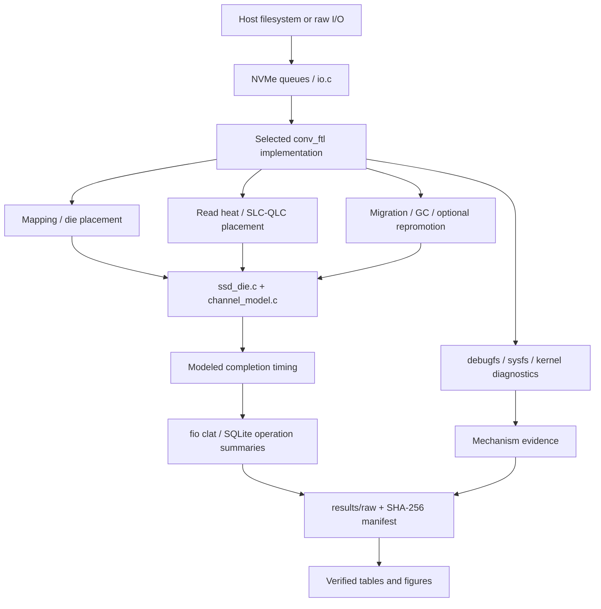

# Architecture / 架构说明

## Request and timing path

SQLite, fio and Filebench issue host requests to the emulated NVMe device. NVMeVirt processes queue entries through the I/O path and delegates address translation to the selected FTL. The FTL chooses physical pages, updates mappings and initiates maintenance. `ssd_die.c` and the channel model calculate device timing and conflicts.

Host DRAM stores the emulated device's data; modeled NAND timing is separate from that storage medium. Filesystem, SQLite and host scheduling costs can also affect application timings. fio completion latency and SQLite operation latency are therefore separate metrics.

## Placement and maintenance families

**Die placement and chain aggregation.** The inherited die-affinity work changes physical page placement for fragmented file access. The integrated FTL adds compile-time chain aggregation and other feature combinations. It requires the compatible host-side kernel interface described by the inherited module documentation.

**SLC/QLC management.** The FTL variants maintain read heat and page mappings, choose cold migration candidates, and optionally enable QLC hot/cold placement, QLC-to-SLC read repromotion or QLC rebalance. `ssd_config.h` currently defines a 20% SLC capacity fraction and tier-specific read timings. These are source defaults, not proof that a historical run used those exact values.

**Maintenance scheduling.** Latency variants share the experiment's SLC migration/GC concerns while changing maintenance scheduling. V1 is the maintenance baseline; V2 introduces per-die idle/demand scheduling; V3 uses foreground-read-priority workers. Wrapper macros can disable repromotion and rebalance even when a filename says `qlc_all`. The [catalog](VARIANTS.md) separates these combinations.

## What establishes a mechanism result

Check three kinds of evidence together:

1. **Configuration:** source, compile flags, runtime controls, geometry, request distribution and address regions.
2. **Execution:** nonzero relevant counters or request/timing traces. A compiled flag alone establishes availability, not activity.
3. **Outcome:** application or fio latency, complete I/O volume, kernel completion diagnostics and remaining maintenance work.

For example, a lower p99 combined with zero read-priority control counters is an observation about that run. It does not establish that the scheduler caused the reduction. Yield counters without completion-priority evidence show worker behavior rather than a completed foreground-read benefit.

## Archived evidence

The included fio comparison has one run per variant and no scoped kernel tail or post-drain snapshots. SQLite logs contain richer diagnostics but incomplete prewarm evidence and mixed operation semantics. See [results/README.md](../results/README.md) before using these files to support a performance claim.
